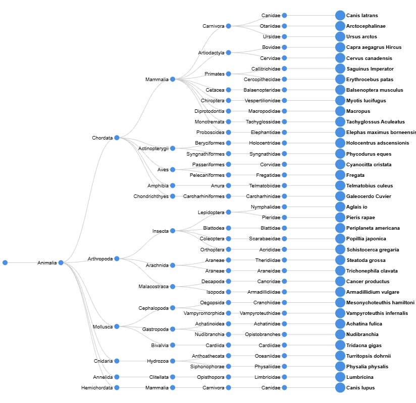
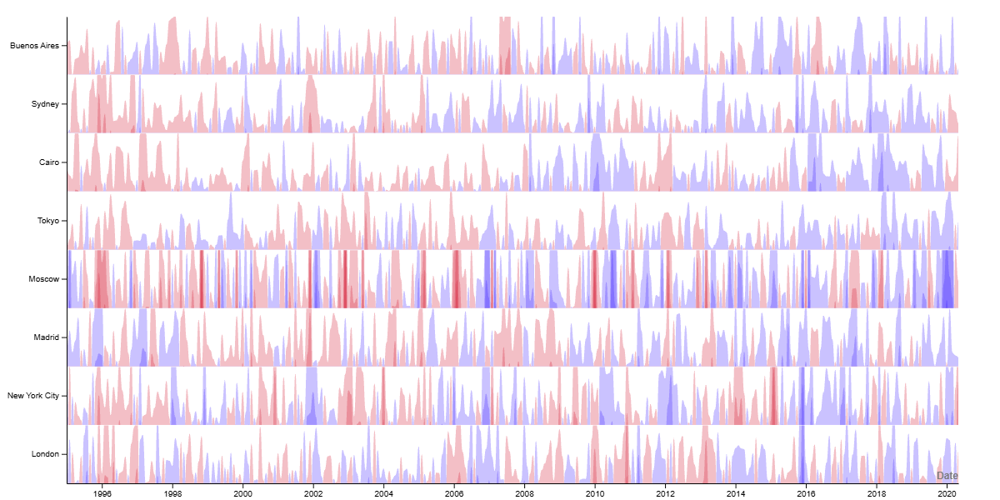

# Visualización de datos - PEC2
Visualizaciones generadas para la PEC2

## Contenido
- Gráficos: visualizaciones desarrolladas para la PEC.
- Datasets: conjunto de datos utilizados.

## Gráfico 1: Dendrograma

Gráfico generado en la herramienta web https://www.rawgraphs.io/

[Descargar dataset](datasets/animalia_subset.csv)

## Gráfico 2: Horizon graph

Gráfico generado en la herramienta web https://www.rawgraphs.io/

[Descargar dataset](datasets/anomalias_temperatura.csv)

## Dataset cartograma

El cartograma lo he generado en Tableau pero añado aquí el dataset.
[Descargar dataset](datasets/population_of_europe_in_2017_by_country.csv)

